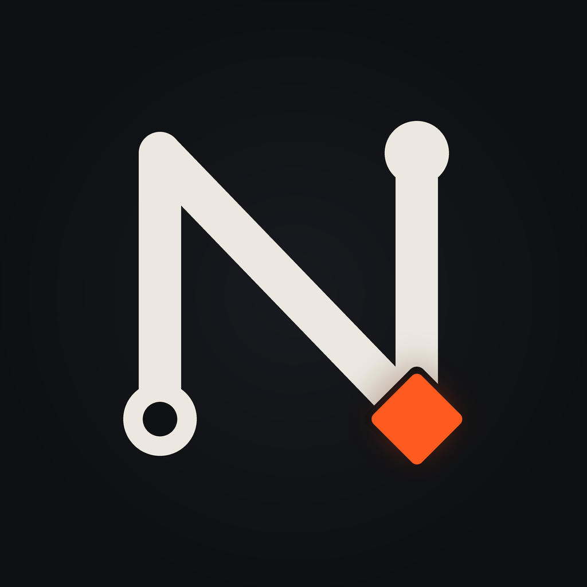

<p align="center"></p>

# NEXUS

Route each Claude Code task to the right model, and watch the session live above the prompt.

[](https://github.com/saidbouras/nexus/actions/workflows/ci.yml)


```
 NEXUS  session 14m  steps 212  tokens 1.9M  cache 91%  est. $4.37
 usage  ▁▂▃▅▇█▆▃▂▁▂▄▆█▇▅   agents ▌main ▌explore ▌impl-1 ▌impl-2
 AGENT      MODEL      STATUS   STEPS  TOKENS   TOOLS
 main       sonnet 5.5 running    41   640k     Read Edit Bash
 impl-1     opus 5.5   running    77   910k     Edit Bash
 ROUTE ▶ coding/high → ▌ opus 5.5  high  conf ████ 0.82  jev  @main  now  ◆◆◆◇◆
```

The sketch is illustrative. Columns depend on the version and the terminal width.

## Why

- A model switch throws away the prompt cache. NEXUS routes per task, not per prompt: it picks a model once the task is clear and keeps it while the cache is warm.
- When a later request needs a stronger model, NEXUS escalates to an Opus subagent (or asks for a second opinion) instead of switching the whole session.
- It works with the Anthropic API through your own Claude access, or with a Databricks AI Gateway.

## Features

- **Router.** A small classifier reads your prompt and returns a category (`fast`, `general`, `reasoning`, `coding`) and a difficulty (`low`, `medium`, `high`). The pair picks a model and an effort.
- **Subagents.** Every subagent is routed on its own task when it is spawned.
- **Escalation.** The `nexus:frontier` subagent type (Opus) and the `consult` tool (a second opinion from a frontier model).
- **HUD.** Live usage, agents, tools, estimated cost and the latest routing decisions.
- **Orchestrator skill.** Guides how work is split across subagents.
- **Report.** `/route report` compares the estimated cost with an all-Opus baseline.
- **Fails open.** If the classifier errors or times out, your request goes out unchanged.

## Install

Requires Claude Code 2.1.275 or later. In a terminal:

```sh
claude plugin install nexus --marketplace saidbouras/nexus
```

Add `--config profile=databricks` to preset a setting. The flag can be repeated as `--config KEY=VALUE`.

Other ways to install:

| Where | Command |
|---|---|
| Inside Claude Code | `/plugin install nexus --marketplace saidbouras/nexus` |
| Two steps | `/plugin marketplace add saidbouras/nexus`, then `/plugin install nexus@nexus` |
| Try without installing | `claude --plugin-dir /path/to/nexus` |

Then run `/reload-plugins` (or restart Claude Code) and check with `/route status`.

Update: `claude plugin marketplace update nexus`, then `claude plugin update nexus@nexus`.
Uninstall: `claude plugin uninstall nexus@nexus`.
Settings: `/plugin configure nexus@nexus`.

Full steps: [docs/INSTALL.md](docs/INSTALL.md).

## Quick start

1. Start sessions on the medium model. Add this to `~/.claude/settings.json`, or run `/model sonnet`:

   ```json
   { "model": "sonnet" }
   ```

2. Pick a profile with `/plugin configure nexus@nexus`:
   - `anthropic` (default): a Haiku classifier through your own Claude access. No extra setup.
   - `databricks`: needs the Databricks CLI. Set `jevUrl` to your gateway endpoint, for example `https://<workspace>.cloud.databricks.com/ai-gateway/typesafe/v1/systemone`, and `databricksProfile` to your CLI profile.

3. Run `/reload-plugins`, then send a prompt. The HUD appears above the prompt, with a `ROUTE` line that shows the category, difficulty, chosen model and confidence. `/route log` lists past decisions.

## How it works

The default `routeMainLoop` mode is `task`:

1. **Start.** The session starts on the model Claude Code is set to (Sonnet in the quick start).
2. **Commit.** Vague prompts at the start of a session ("ok", "let's look at this") change nothing. The first clear prompt picks a model, and that model is committed.
3. **Keep.** While the cache is warm, a lighter or equal model is kept. A heavier one switches only if the context is small (`switchMaxContext`).
4. **Escalate.** If a heavier model is needed and switching would drop the cache, the main model keeps running. NEXUS asks it to hand the hard part to the `nexus:frontier` subagent (Opus) or to call `consult`.
5. **Re-route.** The commitment is dropped after `/clear`, a compaction, a resume, or an idle gap longer than `cacheTtlMinutes`. The next clear prompt can switch freely.

The classifier chain is Jev, then Haiku, then a local Ollama model. A step you did not configure is skipped. A prompt that is only an acknowledgement ("ok", "yes do it") is never classified.

Default matrix (override it with `routes`):

| | `low` | `medium` | `high` |
|---|---|---|---|
| `fast` | Haiku low | Haiku medium | Sonnet medium |
| `general` | Haiku medium | Sonnet medium | Sonnet high |
| `coding` | Sonnet medium | Sonnet high | Opus high |
| `reasoning` | Sonnet high | Opus medium | Opus high |

Details: [Main-loop routing and the prompt cache](docs/CONFIGURATION.md#main-loop-routing-and-the-prompt-cache), [Default matrix](docs/CONFIGURATION.md#default-matrix), [docs/ARCHITECTURE.md](docs/ARCHITECTURE.md).

## Commands

| Command | What it does |
|---|---|
| `/route status` | Routing state, profile, mode, configured classifier steps, last decision. Start here when something looks wrong. |
| `/route on`, `/route off` | Turn routing on or off. The HUD keeps running. |
| `/route pin <category> [difficulty]` | Force a category and difficulty (default `medium`), with no classifier calls. |
| `/route pin off` | Release the pin. |
| `/route log [n]` | Show the latest `n` routing decisions (default 20). No prompt text is stored. |
| `/route log clear` | Empty the decision log. |
| `/route log export [path]` | Write the log and usage records as JSONL. |
| `/route report [n]` | Cost and saving over the last `n` sessions (default 10) against an all-Opus baseline (the `reasoning/high` model, Opus by default). |
| `/workflow` (or `/nexus`) | Cycle the HUD: expanded, collapsed, hidden. |
| `/workflow expand\|collapse\|hide\|pane` | Set the HUD directly, or open the full dashboard in a pane. |

More: [docs/USAGE.md](docs/USAGE.md#route-in-detail).

## Configuration

Open the settings with `/plugin configure nexus@nexus`, then run `/reload-plugins`. An empty value means the default. Keep secrets out of settings; API keys are read from environment variables.

| Setting | Default | What it changes |
|---|---|---|
| `profile` | `anthropic` | `anthropic` or `databricks`. Picks the default model ids and the Haiku classifier model. |
| `routeMainLoop` | `task` | `task`, `adaptive`, `every-turn`, `session-start` or `off`. Subagents are routed in every mode. |
| `switchMaxContext` | `50000` | Largest context (tokens) at which the main model may switch. Above it the model is kept. |
| `switchConfidence` | `0.75` | `task` and `adaptive`: minimum confidence to switch. |
| `cacheTtlMinutes` | `5` | `task`: idle time after which the cache counts as cold. Use `60` if your provider caches for an hour. |
| `chain` | `jev,haiku,local` | Classifier steps, in order. Remove a name to disable that step. |
| `fallbackPolicy` | `ask` | When a step fails: `ask`, `never` (stay on the current model) or `auto`. |
| `jevUrl` | empty | Databricks AI Gateway endpoint. Setting it selects the gateway route. |
| `routes` | empty | JSON that overrides the matrix, by category (`coding`) or cell (`coding.high`). |
| `decisionLog` | `true` | Keep the routing log used by `/route log` and `/route report`. |
| `stallMinutes` | `30` | Minutes of silence before a running subagent triggers a stall alert. `0` turns it off. |

All settings, JSON formats and presets: [docs/CONFIGURATION.md](docs/CONFIGURATION.md) and [presets](presets/README.md).

## Privacy

The classifier sees only your latest prompt (or a subagent's type, description and prompt), cut to 4000 characters. Where it goes depends on the step: your Databricks workspace, Anthropic through your own access, or your machine for the local step. The routing log stores no prompt text. Details: [docs/PRIVACY.md](docs/PRIVACY.md).

## Documentation

- [Install](docs/INSTALL.md)
- [Usage](docs/USAGE.md): what happens on each prompt, when the classifier is called, modes, recipes, `/route` output
- [The HUD](docs/HUD.md): every part of the band, the pane and the route line
- [Configuration](docs/CONFIGURATION.md)
- [Architecture](docs/ARCHITECTURE.md)
- [Troubleshooting](docs/TROUBLESHOOTING.md)
- [Privacy](docs/PRIVACY.md)
- [Changelog](CHANGELOG.md)

## Contributing

See [CONTRIBUTING.md](CONTRIBUTING.md). Security reports: [SECURITY.md](SECURITY.md).

## Limitations

- The direct TypeSafe API route for Jev (no `jevUrl`) is untested.
- The classifier reads each prompt alone, so a follow-up like "do that" can look vague.
- Escalation depends on the main model following the directive. Check with `/route log`.
- Each routed prompt adds one classifier call before the turn starts.
- Developed and tested on macOS. The HUD cost is an estimate, not a bill.

## License

MIT. See [LICENSE](LICENSE).
