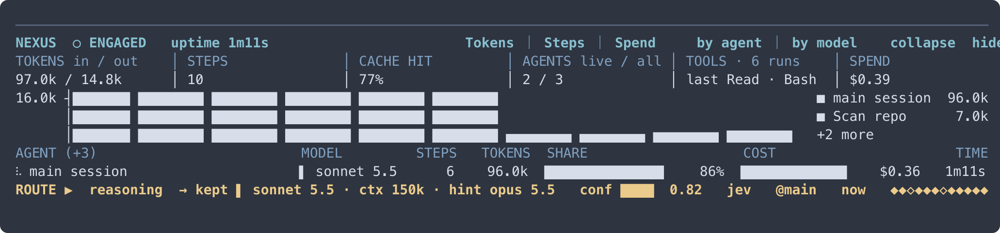
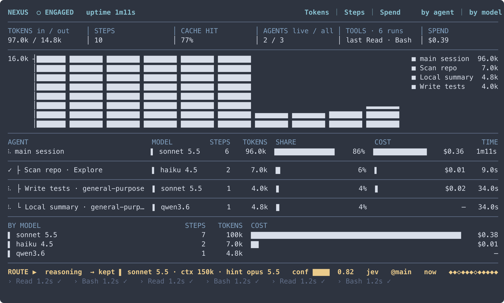

# The HUD

The HUD is the NEXUS dashboard above the Claude Code prompt. It shows what the session is doing: tokens, cache use, agents, tools, estimated cost and the router's latest decisions. It appears after the first model request of a session and needs no setup.

## Show, shrink or hide it

| Command | What it does |
|---|---|
| `/workflow` (or `/nexus`) | Cycles the band: expanded, collapsed (one line), hidden. |
| `/workflow expand` | Shows the full band. |
| `/workflow collapse` | Shows the [one-line form](#the-one-line-form). |
| `/workflow hide` | Hides the band. |
| `/workflow pane` | Opens the [full dashboard](#the-pane) in a pane. |

The band also has `collapse`, `hide` and `expand` buttons you can click. The chosen mode is kept for the next session.

The HUD settings (`prices`, `upliftPct`, `stallMinutes`) are described in [Configuration: HUD](CONFIGURATION.md#hud).

## The band, part by part

The images on this page are text renderings of the HUD's drawing code on a mock session (a main loop on Sonnet with three subagents), not captures of a live terminal. The numbers are demo data, and details can differ from your version. In a real terminal each agent and model has its own color, and the chart is stacked in those colors.

| Part | What it shows |
|---|---|
| **Header** | `NEXUS`, then `● ENGAGED` while a loop is running or `● ONLINE` when idle, and the session uptime. On the right: the chart toggles (`Tokens`, `Steps`, `Spend` choose what the chart stacks; `by agent`, `by model` choose how it is split) and the `collapse` and `hide` buttons. All of them are clickable. |
| **KPI tiles** | `TOKENS in / out` (input includes cache writes), `STEPS` (model requests), `CACHE HIT` (share of input served from the prompt cache), `AGENTS live / all`, `TOOLS · N runs` and `SPEND` (estimated cost). The tools tile names the running tools, newest first, for example `Bash ×2 · Read +1`, with MCP tools shown without their server prefix. While no tool runs it shows the latest finished ones, muted, for example `last Read · Bash`. On a tile too narrow for a name it shows `running / all`. |
| **Chart** | Usage over time, one column per time bucket, stacked by agent or by model. The legend on the right lists the biggest series; `+N more` counts the rest. |
| **Agent table** | One row per loop: the main session, then its subagents as a tree (`├`, `└`). A spinner means running, `✓` done, `✗` failed. `MODEL` is the model of that loop's latest request. `STEPS` and `TOKENS` are its requests and tokens, `SHARE` its part of all tokens, `COST` its estimated spend (`—` when its model has no price) and `TIME` its running time. `AGENT (+N)` means N rows did not fit; running loops get a row first. |
| **Route line** | The router's latest decision. When you view a subagent's transcript, it shows that subagent's decision instead. See [The route line](#the-route-line). |
| **Tools line** | The latest tool runs with their duration and result, when there is room. See [The pane](#the-pane). |

The band takes a quarter of the terminal's height, and at least 10 rows. When rows run short it drops the tools line first, then agent rows; the route line and the chart go last. If even the header does not fit, it falls back to the one-line form.

Below 100 columns the layout is compact: shorter labels and fewer table columns (no `STEPS`). From 160 columns the table adds `TURNS`, `IN`, `OUT` and `LAST ACTIVE`.

The estimated cost comes from a price table, not from your bill. A model without a price counts as unknown, and the spend then covers the priced models only.

## The pane

`/workflow pane` opens the whole dashboard in a pane. It has a taller chart, every agent row, a `BY MODEL` table, the route line and the tools line.

| Pane part | What it shows |
|---|---|
| **`BY MODEL`** | Steps, tokens and estimated cost per model over the session. This is where you see whether routing moved work to cheaper models. |
| **Tools line** | The latest tool runs, newest first, each with its duration and result: `✓` done, `✗` error, `⊘` denied, a spinner while running. |

Before any activity the pane shows `standing by · no activity yet`.

## The route line

`ROUTE ▶ reasoning/high → kept ▌ sonnet 5.5 · ctx 150k · escalated → opus 5.5   conf ████▏ 0.82   jev   @main   now   ◆◆◇◆◆◆◇◆◆◆◆◆`

| Part | Meaning |
|---|---|
| `ROUTE ▶` | The latest decision. `▶` shows for about 2.5 seconds after a new decision; if the category or the model changed, the category is also drawn inverted. |
| `reasoning/high` | The category (`fast`, `general`, `reasoning`, `coding`) and the difficulty (`low`, `medium`, `high`) the classifier chose. On a narrow line, or for a decision without a difficulty, only the category shows. |
| `kept` | The main model was not changed. Without `kept`, the loop runs on the model shown. A kept decision on the same model still applies the route's effort. |
| `▌ sonnet 5.5` | The model the loop runs on, with its color mark. When an effort is set it follows later on the line (for example `high`). |
| `ctx 150k` | The main loop's context size in tokens when the decision was made. The router compares it with `switchMaxContext`. |
| `escalated → opus 5.5` | `task` mode: a heavier model was needed but switching would drop the prompt cache. The model was kept and Claude was told to hand the hard part to the `nexus:frontier` subagent, or to call `consult`. |
| `hint opus 5.5` | The model was kept and a one-line hidden note suggests a subagent for self-contained work. The router puts that subagent on the model named here. |
| `vague` | `task` mode: the prompt did not state a task, so the model stays and nothing is committed. |
| `commit` | `task` mode: this decision committed the session's model. |
| `switched` | The main model switched to the routed one. It appears after the loop name, with the context size. |
| `conf ████▏ 0.82` | The decision's confidence, from 0 to 1: the lower of the category's and the difficulty's confidence. Values below 0.6 are drawn in the warning color. |
| `jev` | What decided: `jev`, `haiku`, `local`, `pin` for `/route pin`, or `frontier` for a `nexus:frontier` subagent (put on the frontier model without a classifier call). |
| `@main` | The loop the decision applies to: `main`, or the name of a subagent. |
| `now` | The age of the decision (`now`, `12s ago`, `3m ago`). |
| `◆◆◇◆…` | The last decisions, up to 12, oldest on the left, each in its model's color. A solid `◆` is a decision at 0.6 confidence or more, a hollow `◇` one below. The number of marks depends on the room left. |

How `switchConfidence`, `switchMaxContext` and `minConfidence` decide these outcomes: [Main-loop routing and the prompt cache](CONFIGURATION.md#main-loop-routing-and-the-prompt-cache).

On a narrow terminal the line drops its less important parts first (the difficulty, then the backend, the effort, the age, the loop and the context size), and keeps the category, the model and the `kept`, `hint` or `escalated` words. Subagent decisions, `session-start` decisions and pinned routes show no action word.

### Main-loop outcomes, by example

| Shown | What happened |
|---|---|
| `coding/high → ▌ opus 5.5   high   conf … 0.82   jev   @main   now   switched · ctx 12.0k` | The model switched to the routed one. The context was small, so re-reading it on the new model cost little. |
| `coding/medium → kept ▌ sonnet 5.5 · ctx 4.0k · commit` | `task` mode: the first clear prompt routed to the model already running. It is kept, the route's effort applies, and the session commits to it. |
| `reasoning/high → kept ▌ sonnet 5.5 · ctx 150k · escalated → opus 5.5` | `task` mode: the model was kept to protect the prompt cache, and Claude was told to hand the hard part to `nexus:frontier`. |
| `fast/low → kept ▌ sonnet 5.5 · ctx 150k · hint haiku 5.5` | The model was kept, and the delegation note suggests a lighter subagent. |
| `general/low → kept ▌ sonnet 5.5 · ctx 2.1k · vague` | `task` mode: the prompt stated no task, so nothing was committed. |
| `coding/medium → kept ▌ sonnet 5.5 · ctx 150k   conf … 0.55` | The model was kept because the confidence was below `switchConfidence`. No note was added. |

`/route log` lists the same outcomes as `switched`, `kept`, `hint`, `escalated`, `vague` and `low-confidence`, with `commit` on the committing entry. See [`/route` in detail](USAGE.md#route-in-detail).

## The one-line form

With `/workflow collapse` the band becomes one line:

`NEXUS ● ENGAGED │ → kept sonnet 5.5 · hint opus 5.5 ◆◆◆◆ │ tok 112k │ cache 77% │ agents 2/3 │ $0.69 │ ⏱ 1m10s`

It shows the state, the latest route with up to four trail marks, total tokens, cache hit, live and total agents, estimated spend and elapsed time. The route is left out when the line is too narrow for it. `expand` and `hide` are buttons at the right end.

## Stall alert

A subagent can stop making progress without failing. The HUD watches for this:

1. Every 60 seconds it checks the running subagents.
2. A subagent that has sent nothing for `stallMinutes` (default 30) is reported once to the main session, as a message from NEXUS. The message names the subagent, its id, how long it has been silent and any tool it is still running. It asks the main session to request a status with `SendMessage`, stop the subagent if it is stuck, and tell you what it found.
3. The HUD also shows a toast.

A subagent is reported once per silence; if it becomes active and then goes silent again, it can be reported again. The main session itself is never reported. A long-running tool counts as silence, and the message names the tool so the main session can judge. Set `stallMinutes` to `0` to turn the alert off.

How it works inside: [Architecture: Stall watch](ARCHITECTURE.md#stall-watch). When it does not behave as expected: [A subagent looks stuck but no alert came](TROUBLESHOOTING.md#a-subagent-looks-stuck-but-no-alert-came) and [The main session got an alert but did nothing](TROUBLESHOOTING.md#the-main-session-got-an-alert-but-did-nothing).

## Limitations

- Whether an idle main session wakes up to answer a stall message has been tested with the engine's test harness only, not in a live session.
